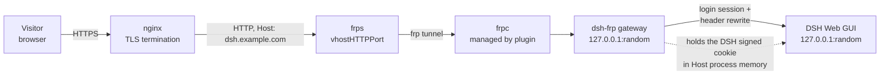

<div align="center">


# dsh-frp

**Expose your local DeepSeek Harness Web GUI through your own frps server — behind an authenticated gateway.**

[](LICENSE)


[Website](https://dsh-frp.tryme.cc) · [中文文档](README.zh-CN.md) · [Architecture](docs/architecture.md) · [Plugin guide](docs/DETAIL.md)

</div>

---

`dsh-frp` is a [DeepSeek Harness](https://github.com/deepseek-ai/deepseek-harness) (DSH) bundle. It manages an
`frpc` process inside DSH, publishes the local DSH Web GUI over an HTTP vhost tunnel to your own
`frps`, and puts a small login gateway in front of it.

The gateway exists for a reason: the DSH GUI enforces its own request fence (loopback host,
matching origin) and hands out a signed, long-lived browser cookie. A plain `frpc` tunnel cannot
pass that fence, and publishing the GUI's cookie to the internet would hand a stranger full
control of the machine. Instead, the plugin terminates the public session itself and keeps the
DSH cookie inside the Host process — it never reaches a browser.

> **Security first:** a working tunnel is remote control of this machine's agent, including this
> plugin's own panel. Read [Security model](#security-model) before you start one.

## Features

- **One entrance, one login.** Visitors see a self-contained login page (Chinese or English,
  following `Accept-Language`) before any DSH content is reachable. HTTP and WebSocket traffic
  both go through the same session check.
- **The DSH cookie never leaves the gateway.** Every proxied response has `Set-Cookie` stripped;
  the browser only holds the gateway's own HMAC-signed session cookie.
- **Credential rotation that actually revokes.** Changing the public password bumps a session
  epoch stored in the Host credential store, invalidating every device immediately.
- **Managed `frpc`.** The panel downloads the pinned `frp` release with an embedded SHA-256,
  or uses a local binary; it supervises the process with backoff, reports the proxy state from
  frpc's admin API (not stdout parsing), and keeps a log tail.
- **Honest status.** The panel names the failing layer — gateway, frpc process, proxy
  registration, or missing configuration — instead of sitting on "Starting"; the public entrance
  answers with its own 502 page when the local GUI is down.
- **Config through DSH.** Settings are persisted with the Host's config editor; secrets go to the
  credential store, never into `cordis.patch.yml`.
- **Zero runtime dependencies.** Plain ESM, Node core modules only.
- **No agent tools, no telemetry.** The bundle registers no tools and does not touch session data;
  its only network peers are your frps, the local GUI, and — when you ask for one — the configured
  frp release URL.

## How it works



1. The plugin starts a loopback-only gateway on an OS-assigned port and exchanges DSH's launch
   token for a signed DSH cookie (kept in memory).
2. It renders `frpc.toml` pointing at that gateway, starts `frpc`, and polls frpc's local admin API
   for the proxy state.
3. A visitor arrives through nginx → frps → frpc → gateway. The gateway requires its own login
   session, normalizes request headers into what the DSH fence accepts, injects the DSH cookie, and
   pipes the response back with `Set-Cookie` removed and `Location` rewritten to the public origin.
4. If the GUI answers `401` to a bodyless request, the gateway re-exchanges the DSH cookie once and
   retries. If the gateway dies, the plugin kills `frpc` immediately: a live tunnel must never
   outlive its authentication layer.

The [architecture document](docs/architecture.md) describes the trust boundaries, header rules,
cookie exchange, supervisor state machine, and failure modes in detail.

## Requirements

| Requirement | Details |
|---|---|
| DSH | **0.2.2-rc.5** tested. The bundle needs `webServer`, `connection`, `webApp`, and `subprocess` services (Desktop or the Web app profile). |
| Node.js | **20 or newer** (the DSH runtime already provides it). |
| frps | **0.64–0.80** is guaranteed with the pinned frpc **0.72.0** (upstream's nine-minor window); **0.72.0** is tested. TOML support starts at 0.52, but older servers are best-effort. Token authentication and `vhostHTTPPort` are required; `subdomainHost` is not. |
| DNS + TLS | A domain whose DNS points at your frps host, and an HTTPS terminator in front of frps (the nginx snippet below). |
| OS | Automatic binary download supports `tar.gz` releases (macOS/Linux/BSD). On Windows, point the plugin at a local `frpc.exe`; zip archives are not unpacked. |
| Firewall | `vhostHTTPPort` (commonly `17002`) and `vhostHTTPSPort` (commonly `17003`) must be reachable **only** from nginx and the host itself. |

## Installation

From GitHub, into an existing profile:

```sh
dsh plugin --profile <profile> add github:trymesoft/dsh-frp
```

From a local checkout:

```sh
dsh plugin --profile <profile> add /path/to/dsh-frp
```

In DSH Desktop, use **Plugins → Add plugin** with the package name, Git URL, a tarball, or a local
directory. Then open **Plugins → frp tunnel** and turn the bundle on.

The plugin has no build step and no install scripts, so installing it never executes generated
code.

## Setup

### 1. Prepare frps and nginx

Your `frps.toml` needs token authentication and an HTTP vhost port. This plugin routes by
`customDomains`, so `subdomainHost` is unnecessary:

```toml
bindPort = 17000
vhostHTTPPort = 17002

auth.method = "token"
auth.token = "<a long random token>"
```

Put TLS in front of the vhost port with nginx. The defaults will 404 and drop WebSockets:
without an explicit `Host` header nginx rewrites it to `$proxy_host`, and any `proxy_set_header`
inside the block disables the whole default header group.

```nginx
map $http_upgrade $connection_upgrade { default upgrade; '' close; }

server {
  listen 443 ssl;
  server_name dsh.example.com;                 # your public domain

  location / {
    proxy_pass http://127.0.0.1:17002;         # frps vhostHTTPPort
    proxy_http_version 1.1;
    proxy_set_header Host $host;               # REQUIRED: frps routes by Host
    proxy_set_header Upgrade $http_upgrade;
    proxy_set_header Connection $connection_upgrade;
    proxy_set_header X-Forwarded-For $remote_addr;   # overwrite, do not append
    proxy_set_header X-Forwarded-Proto $scheme;
    proxy_read_timeout 3600s;                  # WebSocket idle keep-alive
    proxy_send_timeout 3600s;
    client_max_body_size 50m;                  # default 1m blocks uploads
  }
}
```

`X-Forwarded-For` must **overwrite** with `$remote_addr`. frps appends the address it saw
(your nginx) afterwards; the gateway trusts the second-to-last entry as the visitor address.

> Make sure direct access to `17002` / `17003` is blocked by your firewall. Otherwise visitors can
> bypass nginx and reach the same vhost in plain HTTP.

### 2. Configure the tunnel

Open **Plugins → frp tunnel**:

1. **frps connection** — server address, port (`bindPort`, e.g. `17000`), public domain
   (`dsh.example.com`), and the public entrance URL (`https://dsh.example.com`). Save the frps
   auth token in the same section. Saving a connection change reloads the plugin to apply it; if
   the values are unchanged, it does not reload. Saving only the token takes effect the next time
   the tunnel starts.
2. **frpc binary** — click **Download automatically (sha256 verified)** for the pinned release, or
   enter an absolute path to a local `frpc`. A binary already on disk is detected after a reload.
3. **Public sign-in** — choose a username and a password of at least 12 characters. Changing the
   password signs every signed-in device out.
4. **Start tunnel** — the status goes `Starting` → `Running`, and the public URL becomes
   copyable. Failures name their cause (token rejected, proxy not registered within 30 s, crash
   loop) instead of hanging on "Starting".

`autoStart` starts the tunnel when the plugin loads. It is off by default and honored only when
the start gate passes. The **frpc runtime** card sets it: the switch saves through the same config
editor, so ticking or unticking reloads the plugin and therefore starts or stops the tunnel right
then, not at the next boot. With no cached `frpc`, the first resume downloads the binary.

## Configuration

These are the Loader row fields (`cordis.patch.yml`); the panel edits them through the Host config
editor.

| Key | Default | Meaning |
|---|---|---|
| `enabled` | `true` | Mount the plugin at all. |
| `autoStart` | `false` | Start the tunnel on plugin load when prerequisites are met. Also editable from the panel's runtime card. |
| `publicBaseUrl` | `""` | Public entrance origin, e.g. `https://dsh.example.com` (scheme + host, no path). Also decides `Secure` / `__Host-` on the gateway cookie. |
| `frps.serverAddr` | `""` | frps host name or IP. |
| `frps.serverPort` | `7000` | frps `bindPort`. |
| `frps.domain` | `""` | Public vhost domain, written to `customDomains`. |
| `frps.transport.useTLS` | `true` | frpc ↔ frps TLS. Written explicitly to `transport.tls.enable`. |
| `frpc.binaryPath` | `""` | Absolute path to `frpc`; empty means use the managed download cache. |
| `frpc.downloadVersion` | `0.72.0` | frp release to download. Only pinned versions have an embedded checksum. |
| `frpc.downloadBaseUrl` | `https://github.com/fatedier/frp/releases/download` | Release base URL or mirror prefix; must be HTTPS (HTTP is allowed only for a loopback mirror). |
| `gateway.sessionTtlHours` | `12` | Gateway session cookie lifetime. |
| `login.username` | `""` | Public sign-in username. |

**Not configuration.** These are secrets and live in the DSH credential store (or in
`$DSH_HOME/dsh-frp/credentials.json` with mode `0600` when the profile has no credential service):
frps auth token, public password, gateway session signing secret, session epoch, and the randomly
generated frpc admin credentials. They never appear in `cordis.patch.yml` or in the panel's
status payload.

## Security model

**What a working tunnel means.** The public entrance is equivalent to full control of the DSH
agent on this machine, including the plugin panel that can start, stop, and reconfigure the
tunnel. Treat the password like an SSH key. This is a **single-user view**: every visitor sees the
same DSH session scope; there is no per-user isolation.

**What the plugin does**

- Requires its own gateway session for every request, including WebSocket upgrades. Unknown
  `Host` headers are refused (404) even before authentication, so a direct hit on the loopback
  port is not a second entrance.
- Keeps the DSH signed cookie in Host process memory. Upstream `Set-Cookie` / `Set-Cookie2` are
  always stripped; the browser never receives them.
- Signs gateway sessions with an HMAC over `{exp, epoch}`, stored in the credential store. Bumping
  the epoch (password change) invalidates all outstanding sessions. Cookies are `HttpOnly`,
  `SameSite=Strict`, `Path=/`, host-only, and `Secure` + `__Host-` prefixed when `publicBaseUrl`
  is HTTPS.
- Compares credentials in constant time and applies a **global** failure delay (1 s, doubling to
  30 s, decaying slowly). It is deliberately not per-IP: in this topology the gateway's TCP peer is
  always `127.0.0.1`, and headers a client sends before the proxy chain cannot be trusted.
- Normalizes inbound headers: rewrites `Host`, replaces `Cookie`, drops `Origin`, `Sec-Fetch-Site`,
  and forwarded headers, restores the visitor IP from the trusted XFF chain, strips hop-by-hop
  headers, and rejects messages carrying both `Transfer-Encoding` and `Content-Length`.
- Listens on `127.0.0.1` only, with an OS-assigned port; `frpc` points at it. If the gateway errors
  or stops, the plugin kills `frpc` so a stale route cannot outlive authentication.
- Generates `frpc.toml` with a per-start random proxy name, a loopback admin API with random
  credentials, and a TCP health check; the file is written `0600`.
- Verifies downloaded archives against SHA-256 values pinned in the source for frp `0.72.0`.
  A version without a pinned hash requires an explicit consent prompt in the panel.

**What it does not do**

- **TLS termination.** The gateway speaks plain HTTP on loopback. The public side is HTTPS only if
  your nginx is; the plugin cannot verify or enforce that.
- **Multi-user accounts or audit logs.** One credential pair, one shared DSH view.
- **MFA.** Use a long random password.
- **Reverse-proxy hardening beyond this topology.** Put frps behind a firewall; do not expose the
  vhost port directly.

**Privacy**

The plugin has no telemetry or analytics. It talks to the local DSH GUI over loopback, to your
frps through `frpc`, and — only when you request a binary download — to the configured release URL
(GitHub by default, or your mirror).

**Recommendations**

- Use a password manager-generated password (20+ characters).
- Keep `17002`/`17003` closed to the internet and terminate TLS at nginx.
- Stop the tunnel when you do not need remote access.
- Keep DSH and the plugin updated; re-check this section after major versions.

## Troubleshooting

| Symptom | Likely cause | Fix |
|---|---|---|
| nginx returns 404 or the login page never loads | nginx rewrote `Host` to `$proxy_host`, or `vhostHTTPPort` is wrong | Set `proxy_set_header Host $host;` and check `proxy_pass`. |
| GUI loads but WebSocket features die after ~60 s | nginx `proxy_read_timeout` closed the idle socket | Set both proxy timeouts to `3600s`. |
| 504 on slow API calls | frps `vhostHTTPTimeout` (default 60 s) is a response-header timeout | Raise it in `frps.toml`, or use streaming responses where possible. |
| Panel reports **The gateway stopped listening** | The gateway crashed or its port was taken | Reload the plugin; if it repeats, open the Host log. |
| Panel shows **Error: frps rejected the proxy** | Bad token, domain already taken, or port mismatch | Check the panel's status detail and `frpc` logs. |
| **frpc failed N times in a row** | Wrong server address/port, token, or missing TLS settings | Open **Show logs**; fix the frps connection and press **Start tunnel** again. |
| Public page shows **502 · DSH is unreachable** | The gateway is up but the local GUI is not answering | Check that DSH is running; the gateway keeps its own session. |
| Public page shows the frps error page instead of the login page | `frpc` is down or the proxy is not registered | Check tunnel state in the panel; frps has no route. |
| **Missing frpc** right after a reload | The previous Host modules were still loaded (local link install) | Restart DSH so the new Host modules load. |
| macOS refuses to run a manually downloaded `frpc` | Gatekeeper quarantine | `xattr -d com.apple.quarantine /path/to/frpc`, or use the managed download. |

## Development

The repository is plain ESM with no build step and no runtime dependencies.

```text
src/
  index.js            Host entry: Config, wiring, panel route, autoStart
  gateway.js          Login page, session check, HTTP proxy, WebSocket relay
  gateway-session.js  HMAC session cookies, epoch handling, login throttle
  header-rules.js     Header normalization, Location rewriting, hop-by-hop rules
  frpc-config.js      frpc TOML generation with strict escaping
  frpc-manager.js     Binary download/verification and process supervision
  status-routes.js    Panel API, start gate, DSH cookie exchange
  client.js           Web panel (plugins.bundle.config slot)
locale/               Panel titles and descriptions (en, zh)
docs/                 Architecture and plugin detail pages
test/                 node:test suites (116 tests)
```

```sh
npm test          # node --test test/
npm run check     # syntax-check every module, then run the tests
```

Tests use `node:test` and need no network: the DSH GUI is a stub HTTP upstream and `frpc` is a
stub script; frps is never contacted.

To try a local checkout, install it with `dsh plugin --profile <profile> add .` and restart DSH
after changing Host-side modules (the Client half hot-reloads; Host modules do not). See
[Architecture](docs/architecture.md) for the design and [DETAIL](docs/DETAIL.md) for the
end-user guide.

## Limitations

- One tunnel target: this DSH GUI. No multi-proxy or multi-domain management.
- No public-side TLS termination; bring your own nginx (or equivalent).
- Automatic binary download only handles `tar.gz` releases; Windows needs a manual `frpc.exe`.
- No multi-user accounts, per-user DSH sessions, or audit trail.
- frp major/minor compatibility follows upstream: pin frpc and frps to the same minor when
  possible.

## License

[MIT](LICENSE) © 2026 trymesoft.

Not affiliated with DeepSeek or the [frp](https://github.com/fatedier/frp) project. frp is a
separate open-source project by fatedier; this plugin only launches its client.
