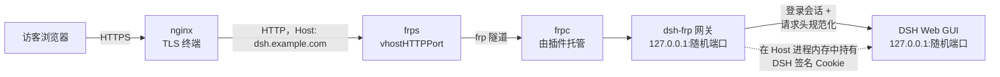

<div align="center">


# dsh-frp

**经自有 frps 把本机 DeepSeek Harness Web GUI 发布到公网——入口由带登录页的网关把守。**

[](LICENSE)


[English](README.md) · [架构说明](docs/architecture.md) · [插件使用说明](docs/DETAIL.zh.md)

</div>

---

`dsh-frp` 是一个 [DeepSeek Harness](https://github.com/deepseek-ai/deepseek-harness)（DSH）bundle。
它在 DSH 进程内托管 `frpc`，把本机 DSH Web GUI 经 HTTP vhost 隧道发布到自有的 `frps`，并在前面
加一个轻量登录网关。

网关不是可选项：DSH GUI 自带请求围栏（只信 loopback Host 与同源 Origin），并会下发长期有效的
签名 Cookie。裸 `frpc` 隧道过不了这道围栏；而把 GUI 的 Cookie 交给公网浏览器，等于把整机
Agent 的控制权交出去。因此插件自己终结公网会话，并把 DSH Cookie 留在 Host 进程内——它永远
不会到达浏览器。

> **安全前提：** 隧道一旦可用，就等于这台机器上 Agent 的远程控制权（包括本插件的配置面板）。
> 启动前请先读[安全模型](#安全模型)。

## 功能特性

- **一个入口，一次登录。** 访客先看到插件自带的登录页（按 `Accept-Language` 显示中文或英文），
  之后才能触达任何 DSH 内容。HTTP 与 WebSocket 走同一套会话校验。
- **DSH Cookie 不出网关。** 所有代理响应都会剥掉 `Set-Cookie`；浏览器只持有网关自己的
  HMAC 签名会话 Cookie。
- **改密码即时全线注销。** 修改公网密码会递增凭据库里的会话纪元，所有设备上的旧会话立即失效。
- **托管的 `frpc`。** 面板可下载钉定版本的 `frp`（内嵌 SHA-256 校验），也可指定本机二进制；
  进程按指数退避守护，代理状态取自 frpc 本地 admin API（不解析 stdout），并保留日志尾部。
- **状态不撒谎。** 面板会指出出问题的是网关、frpc 进程、代理注册还是配置缺失，而不是一直停在
  「启动中」；本机 GUI 不可达时，公网入口会给出自己的 502 页面。
- **配置走 DSH。** 设置经 Host 的 config editor 持久化；秘密只进凭据存储，绝不写进
  `cordis.patch.yml`。
- **零运行时依赖。** 纯 ESM，只用 Node 核心模块。
- **不注册 Agent 工具、无遥测。** 不触碰会话数据；网络对端只有你的 frps、本机 GUI，以及你主动
  请求下载时的 frp 发布地址。

## 工作原理



1. 插件在 loopback 上启动 OS 分配端口的网关，用 DSH 的 launch token 换取签名 Cookie（仅存内存）。
2. 生成指向该网关的 `frpc.toml`，拉起 `frpc`，并轮询 frpc 本地 admin API 获取代理状态。
3. 访客经 nginx → frps → frpc → 网关到达。网关要求自己的登录会话，把请求头规范化为 DSH 围栏
   可接受的形式，注入 DSH Cookie，再把响应转发回去，同时剥掉 `Set-Cookie`、把 `Location`
   改写为公网 origin。
4. 若 GUI 对无请求体的请求返回 `401`，网关重换一次 DSH Cookie 后重试；若网关异常退出，插件立即杀掉 `frpc`：
   隧道绝不允许比鉴权层活得更久。

请求生命周期、头规则、Cookie 交换、状态机与失败模式的细节见[架构说明](docs/architecture.md)。

## 环境要求

| 项目 | 说明 |
|---|---|
| DSH | 实测 **0.2.2-rc.5**。bundle 依赖 `webServer`、`connection`、`webApp`、`subprocess` 服务（Desktop 或 Web app profile）。 |
| Node.js | **20 及以上**（DSH 运行时已自带）。 |
| frps | 与钉定的 frpc **0.72.0** 保证兼容的是 **0.64–0.80**（上游九个小版本的兼容窗口），实测 **0.72.0**。TOML 自 0.52 起支持，更老的版本尽力而为。需开启 token 认证与 `vhostHTTPPort`；**不需要** `subdomainHost`。 |
| DNS + TLS | 域名 DNS 指向 frps 主机，并在 frps 前用 HTTPS 终端（见下方 nginx 片段）。 |
| 系统 | 自动下载仅支持 `tar.gz` 发布包（macOS/Linux/BSD）。Windows 请手动指定 `frpc.exe`；插件不解压 zip。 |
| 防火墙 | `vhostHTTPPort`（常见 `17002`）与 `vhostHTTPSPort`（常见 `17003`）**只**允许 nginx 与本机访问。 |

## 安装

从 GitHub 安装到已有 profile：

```sh
dsh plugin --profile <profile> add github:trymesoft/dsh-frp
```

从本地检出安装：

```sh
dsh plugin --profile <profile> add /path/to/dsh-frp
```

在 DSH Desktop 中，使用 **Plugins → Add plugin**，可填包名、Git 地址、压缩包或本地绝对路径。
安装后打开 **插件 → 公网穿透（frp）** 并启用该 bundle。

插件没有构建步骤，也没有安装脚本，安装过程不会执行生成的代码。

## 配置步骤

### 1. 准备 frps 与 nginx

`frps.toml` 需要 token 认证与 HTTP vhost 端口。插件用 `customDomains` 路由，所以不需要
`subdomainHost`：

```toml
bindPort = 17000
vhostHTTPPort = 17002

auth.method = "token"
auth.token = "<一串足够长的随机 token>"
```

在 vhost 端口前用 nginx 做 TLS 终端。默认配置会 404 并掐断 WebSocket：未显式设置时 nginx 把
`Host` 改写为 `$proxy_host`，而块内只要出现一个 `proxy_set_header`，默认头组就整体失效。

```nginx
map $http_upgrade $connection_upgrade { default upgrade; '' close; }

server {
  listen 443 ssl;
  server_name dsh.example.com;                 # 你的公网域名

  location / {
    proxy_pass http://127.0.0.1:17002;         # frps vhostHTTPPort
    proxy_http_version 1.1;
    proxy_set_header Host $host;               # 必须：frps 按 Host 路由
    proxy_set_header Upgrade $http_upgrade;
    proxy_set_header Connection $connection_upgrade;
    proxy_set_header X-Forwarded-For $remote_addr;   # 覆写式，不要追加
    proxy_set_header X-Forwarded-Proto $scheme;
    proxy_read_timeout 3600s;                  # WebSocket 空闲保活
    proxy_send_timeout 3600s;
    client_max_body_size 50m;                  # 默认 1m 会挡上传
  }
}
```

`X-Forwarded-For` 必须是**覆写式**（`$remote_addr`）：frps 会在其后追加它看到的对端地址（你的
nginx），网关取倒数第二个条目作为访客真实地址。

> 请确认防火墙已封住 `17002` / `17003`。否则访客可以绕过 nginx，用明文 HTTP 直接访问同一 vhost。

### 2. 配置隧道

打开 **插件 → 公网穿透（frp）**：

1. **frps 连接** — 填服务器地址、端口（`bindPort`，如 `17000`）、公网域名
   （`dsh.example.com`）与公网入口 URL（`https://dsh.example.com`），并在同一区域保存 frps
   token。保存连接参数会重载插件以应用新值；值没变则不会重载。只保存 token 时，新 token 在下次
   启动隧道时生效。
2. **frpc 二进制** — 点 **自动下载（校验 sha256）** 获取钉定版本，或填写本机 `frpc` 的绝对路径。
   已下载的二进制在插件重载后仍会被识别。
3. **公网登录** — 设置用户名与至少 12 位的密码。改密码会立即注销所有已登录设备。
4. **启动隧道** — 状态从 **启动中** 变为 **运行中**，公网地址可复制。失败会说明原因
   （token 被拒、30 秒内代理未注册、连续崩溃），而不是一直停在「启动中」。

`autoStart` 会在插件加载时自动启动隧道；默认关闭，且只在启动条件满足时生效。

## 配置项

以下是 Loader 行字段（`cordis.patch.yml`），面板通过 Host config editor 修改它们。

| 键 | 默认值 | 含义 |
|---|---|---|
| `enabled` | `true` | 是否挂载插件。 |
| `autoStart` | `false` | 插件加载且前置条件满足时自动启动隧道。 |
| `publicBaseUrl` | `""` | 公网入口 origin，如 `https://dsh.example.com`（协议 + 主机，不带路径）。也决定网关 Cookie 是否加 `Secure` / `__Host-`。 |
| `frps.serverAddr` | `""` | frps 主机名或 IP。 |
| `frps.serverPort` | `7000` | frps `bindPort`。 |
| `frps.domain` | `""` | 公网 vhost 域名，写入 `customDomains`。 |
| `frps.transport.useTLS` | `true` | frpc ↔ frps 传输 TLS，显式写入 `transport.tls.enable`。 |
| `frpc.binaryPath` | `""` | `frpc` 绝对路径；为空则使用托管下载缓存。 |
| `frpc.downloadVersion` | `0.72.0` | 要下载的 frp 版本。只有钉定版本带内嵌校验和。 |
| `frpc.downloadBaseUrl` | `https://github.com/fatedier/frp/releases/download` | 发布包基地址或镜像前缀；必须是 HTTPS（仅 loopback 镜像允许 HTTP）。 |
| `gateway.sessionTtlHours` | `12` | 网关会话 Cookie 有效期。 |
| `login.username` | `""` | 公网登录用户名。 |

**不属于配置的秘密。** 以下值存放在 DSH 凭据库（profile 无凭据服务时落到
`$DSH_HOME/dsh-frp/credentials.json`，权限 `0600`）：frps token、公网密码、网关会话签名密钥、
会话纪元，以及随机生成的 frpc admin 凭据。它们不会出现在 `cordis.patch.yml` 或面板状态响应里。

## 安全模型

**可用隧道的含义。** 公网入口等价于这台机器上 DSH Agent 的完全控制权，包括可以启停、重配隧道的
本插件面板。请像对待 SSH 私钥一样对待这个密码。这里是**单用户视角**：所有访客共享同一份 DSH
会话范围，没有按用户隔离。

**插件做了什么**

- 每个请求（含 WebSocket upgrade）都必须持有网关会话。未知 `Host` 在鉴权前就直接 404，
  因此直连 loopback 端口不构成第二个入口。
- DSH 签名 Cookie 只存 Host 进程内存。上游 `Set-Cookie` / `Set-Cookie2` 一律剥离，浏览器
  永远收不到。
- 网关会话用 HMAC 签名 `{exp, epoch}`，密钥存凭据库。递增纪元（改密码）即作废所有未过期会话。
  Cookie 带 `HttpOnly`、`SameSite=Strict`、`Path=/`、host-only；`publicBaseUrl` 为 HTTPS 时
  追加 `Secure` 并使用 `__Host-` 前缀。
- 凭据比较为常量时间，并施加**全局**失败延迟（1 秒起、逐次翻倍至 30 秒，之后缓慢衰减）。
  故意不按 IP：此拓扑下网关的 TCP 对端恒为 `127.0.0.1`，而客户端在进入代理链之前写的头不可信。
- 入向头规范化：改写 `Host`、整体替换 `Cookie`、丢弃 `Origin` / `Sec-Fetch-Site` / 转发系头，
  从可信 XFF 链恢复访客 IP；双向剥除 hop-by-hop 头；同时带 `Transfer-Encoding` 与
  `Content-Length` 的请求直接 400。
- 只监听 `127.0.0.1`，端口由 OS 分配；`frpc` 指向它。网关报错或停止时插件立即杀掉 `frpc`，
  避免残留路由比鉴权层活得更久。
- 生成的 `frpc.toml` 使用每次启动随机的代理名、带随机凭据的 loopback admin API 与 TCP 健康检查，
  文件权限 `0600`。
- 下载的 frp `0.72.0` 发布包按源码内钉定的 SHA-256 校验。没有钉定哈希的版本必须在面板里显式
  确认风险后才会下载。

**插件不做什么**

- **不终结 TLS。** 网关在 loopback 上说明文 HTTP。公网侧是否 HTTPS 完全取决于你的 nginx，
  插件无法验证或强制。
- **没有多用户账号与审计日志。** 一套凭据，一份共享的 DSH 视图。
- **没有 MFA。** 请使用足够长的随机密码。
- **不超出本拓扑的反代加固。** 请把 frps 放在防火墙后，不要直接暴露 vhost 端口。

**隐私**

插件没有遥测或统计。它经 loopback 与本机 DSH GUI 通信、经 `frpc` 与你的 frps 通信，并且只在
你主动请求下载二进制时访问配置的发布地址（默认 GitHub，或你的镜像）。

**建议**

- 用密码管理器生成 20 位以上随机密码。
- 保持 `17002`/`17003` 对公网关闭，TLS 在 nginx 终结。
- 不需要远程访问时停止隧道。
- 跟进 DSH 与本插件更新；大版本升级后重新核对本节。

## 常见问题

| 现象 | 可能原因 | 处理 |
|---|---|---|
| nginx 返回 404，或登录页根本打不开 | nginx 把 `Host` 改写成了 `$proxy_host`，或 `vhostHTTPPort` 填错 | 设置 `proxy_set_header Host $host;` 并核对 `proxy_pass`。 |
| GUI 能打开，但约 60 秒后 WebSocket 功能失效 | nginx `proxy_read_timeout` 掐掉了空闲连接 | 把两个超时都设为 `3600s`。 |
| 慢接口 504 | frps `vhostHTTPTimeout`（默认 60 秒）是响应头超时 | 调大 `frps.toml` 中的值；可能的话改用流式响应。 |
| 面板提示**网关已停止监听** | 网关崩溃或端口被占用 | 重载插件；反复出现请查看 Host 日志。 |
| 面板报 **frps 拒绝了代理** | token 错、域名被占或端口不匹配 | 看面板状态详情与 `frpc` 日志。 |
| **frpc 连续 N 次启动失败** | 服务器地址/端口、token 或 TLS 设置错误 | 展开日志；修正 frps 连接后重新点**启动隧道**。 |
| 公网页面显示 **502 · DSH 暂时无法访问** | 网关活着，但本机 GUI 没应答 | 检查 DSH 是否在运行；网关会保留自己的会话。 |
| 公网页面显示 frps 的错误页而不是登录页 | `frpc` 已停或代理未注册 | 在面板确认隧道状态；frps 上没有路由。 |
| 重载后马上又报**缺少 frpc** | 本地 link 安装时旧 Host 模块仍在运行 | 重启 DSH，让新的 Host 模块加载。 |
| macOS 拒绝运行手动下载的 `frpc` | Gatekeeper 隔离标记 | `xattr -d com.apple.quarantine /path/to/frpc`，或改用托管下载。 |

## 开发

仓库是纯 ESM，无构建步骤、无运行时依赖。

```text
src/
  index.js            Host 入口：Config、装配、面板路由、autoStart
  gateway.js          登录页、会话校验、HTTP 代理、WebSocket 中继
  gateway-session.js  HMAC 会话 Cookie、纪元处理、登录限速
  header-rules.js     请求头规范化、Location 改写、hop-by-hop 规则
  frpc-config.js      带严格转义的 frpc TOML 生成
  frpc-manager.js     二进制下载/校验与进程守护
  status-routes.js    面板 API、启动门控、DSH Cookie 交换
  client.js           Web 面板（plugins.bundle.config 插槽）
locale/               面板标题与描述（en、zh）
docs/                 架构文档与插件详情页
test/                 node:test 测试（116 个）
```

```sh
npm test          # node --test test/
npm run check     # 先逐文件语法检查，再跑测试
```

测试基于 `node:test`，不需要网络：DSH GUI 用桩 HTTP 上游、frpc 用桩脚本，全程不接触 frps。

本地试装用 `dsh plugin --profile <profile> add .`。改 Host 侧模块后需重启 DSH（Client 半边可热
加载，Host 模块不会）。设计细节见[架构说明](docs/architecture.md)，终端用户指南见
[插件使用说明](docs/DETAIL.zh.md)。

## 已知限制

- 只穿透一个目标：本机 DSH GUI。不做多代理、多域名管理。
- 不终结公网侧 TLS；请自备 nginx（或等效组件）。
- 自动下载只处理 `tar.gz`；Windows 需手动提供 `frpc.exe`。
- 没有多用户账号、按用户的 DSH 会话或审计记录。
- frp 兼容窗口随上游策略：尽量让 frpc 与 frps 同 minor。

## 许可证

[MIT](LICENSE) © 2026 trymesoft。

与 DeepSeek 及 [frp](https://github.com/fatedier/frp) 项目无隶属关系。frp 是 fatedier 维护的
独立开源项目，本插件只负责托管其客户端。
