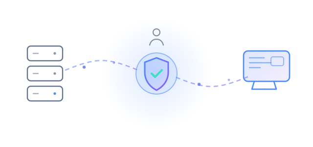

# dsh-frp — publish this DSH through your own frps



`dsh-frp` publishes this machine's DSH Web GUI on a domain you own. It runs an `frpc` child process,
generates its configuration, and puts a login gateway in front of the tunnel. Visitors sign in to
the gateway before any DSH content is reachable, and DSH's signed browser cookie never leaves the
Host process.

## Before you start

- **frps 0.64–0.80** for guaranteed compatibility with the pinned frpc 0.72.0 (tested on
  0.72.0). TOML support starts at 0.52, but older servers are best-effort. Token authentication
  and `vhostHTTPPort` are required; `subdomainHost` is not needed.
- A **domain** whose DNS points at the frps host.
- An **HTTPS reverse proxy** in front of the vhost port. The defaults will 404 and drop
  WebSockets; use this nginx block:

```nginx
map $http_upgrade $connection_upgrade { default upgrade; '' close; }
server {
  listen 443 ssl;
  server_name dsh.example.com;
  location / {
    proxy_pass http://127.0.0.1:17002;              # frps vhostHTTPPort
    proxy_http_version 1.1;
    proxy_set_header Host $host;                    # required: frps routes by Host
    proxy_set_header Upgrade $http_upgrade;
    proxy_set_header Connection $connection_upgrade;
    proxy_set_header X-Forwarded-For $remote_addr;  # overwrite, never append
    proxy_set_header X-Forwarded-Proto $scheme;
    proxy_read_timeout 3600s;
    proxy_send_timeout 3600s;
    client_max_body_size 50m;
  }
}
```

- A firewall rule that keeps `vhostHTTPPort` (17002) and `vhostHTTPSPort` (17003) reachable only
  from nginx and the host itself.

## Use it

1. Open **Plugins → frp tunnel**.
2. Fill in the frps address, port, public domain, and public entrance URL
   (`https://dsh.example.com`), and save the frps auth token.
3. Get the `frpc` binary: use **Download automatically** (SHA-256 verified) or enter an absolute
   path to a local binary.
4. Set the **public sign-in** username and a password of at least 12 characters.
5. Click **Start tunnel**; when the status is **running**, copy the public URL.

When DSH restarts, `autoStart` restores the tunnel if the start prerequisites still hold. The
switch is in the **frpc runtime** card, and toggling it reloads the plugin: it starts or stops the
tunnel right away rather than at the next restart.

## Security

The entrance has the same authority as the DSH agent on this machine, including this panel. Use a
long random password, keep the vhost ports firewalled, and terminate TLS in your reverse proxy. The
entrance is a **single-user view**: every visitor sees the same DSH sessions, with no per-user
isolation. Changing the password signs every device out immediately.

## Limits

- One target (this DSH GUI); no multi-proxy or multi-domain management.
- No public TLS termination in the plugin; that belongs to your reverse proxy.
- Automatic binary download supports `tar.gz` releases; Windows needs a local `frpc.exe`.
- No multi-user accounts or audit log.

The full guide, configuration reference, and troubleshooting table are in
[README.md](../README.md).
