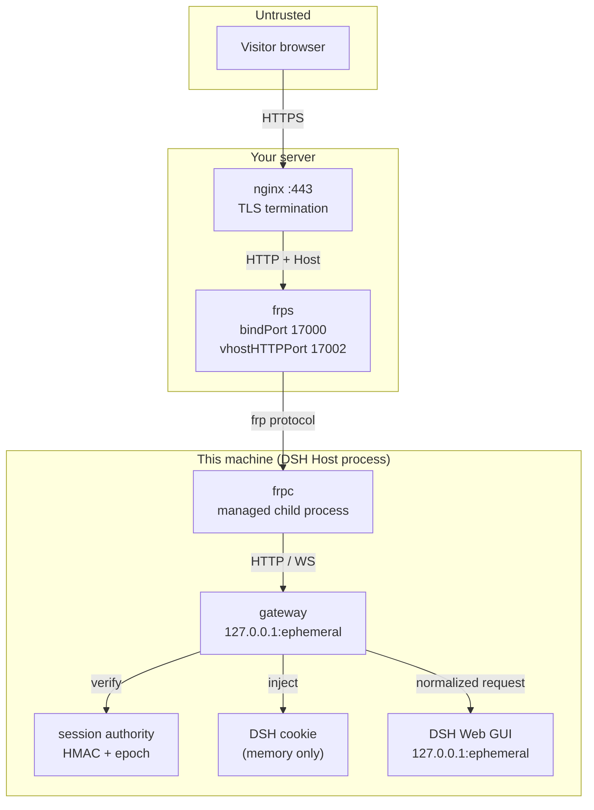
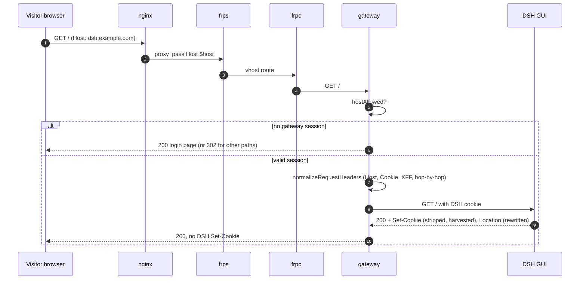
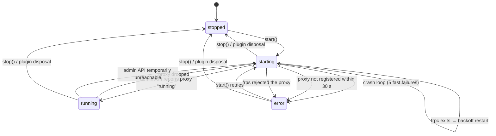

# Architecture

This document explains how `dsh-frp` works, why it is shaped this way, and where the trust
boundaries are. It is meant for contributors and for anyone reviewing the security of a public
DSH entrance. Code references point at the modules in [`src/`](../src).

## The problem

Three properties of DSH make a plain `frpc` tunnel insufficient:

1. **The GUI's request fence.** The DSH Web GUI accepts requests only when `Host` is a loopback or
   bound address, `Origin` matches the request authority, and the fetch is not cross-site. A
   visitor arriving from the internet sends `Host: dsh.example.com` and `Origin:
   https://dsh.example.com`, so frpc's `localPort` answer would be rejected with `403`.
2. **The DSH cookie is the whole machine.** After a launch-token exchange the GUI mints a signed
   cookie (`HttpOnly`, `SameSite=Strict`, 30-day absolute lifetime by default). Handing that cookie
   to a public browser is equivalent to handing over the agent.
3. **The GUI port is dynamic.** Desktop starts the Web app with `--port 0`, so the origin changes
   on every Host start. Any design that hard-codes a port breaks after a restart.

The plugin therefore owns a single authenticated hop between the public tunnel and the GUI:

- It runs a **gateway** on `127.0.0.1:<random>` that speaks plain HTTP and holds the DSH cookie in
  process memory.
- It gives visitors its **own** login session, so the DSH cookie never leaves the process.
- It **rewrites** the request in both directions so the GUI's fence is satisfied only for requests
  that already passed the login.
- It **manages frpc** so the tunnel always points at the current gateway port and dies with it.

## Components

| Module | Responsibility |
|---|---|
| [`index.js`](../src/index.js) | Host entry. Canonicalizes Config, opens the plugin data directory, loads secrets, composes the gateway, manager, and panel API, registers the panel route, performs the first DSH cookie exchange, honors `autoStart`, and releases everything through `ctx.effect`. |
| [`gateway.js`](../src/gateway.js) | Loopback HTTP server. Renders the login page, validates gateway sessions, proxies HTTP, relays WebSocket upgrades, rewrites headers and `Location`, strips `Set-Cookie`, and serves localized error pages. |
| [`gateway-session.js`](../src/gateway-session.js) | HMAC-signed session cookies (`{exp, epoch}`), cookie attributes, constant-time comparison, and the global login throttle. |
| [`header-rules.js`](../src/header-rules.js) | Pure functions for hop-by-hop stripping, framing-conflict detection, XFF parsing, request normalization, and response rewriting. Everything security-relevant about headers lives here so it can be audited in one file. |
| [`frpc-config.js`](../src/frpc-config.js) | Renders `frpc.toml` with TOML string escaping, port/text validation, and a per-start random proxy name. |
| [`frpc-manager.js`](../src/frpc-manager.js) | Downloads and verifies the pinned frp release, extracts it, spawns `frpc`, polls its admin API, restarts with backoff, buffers logs, and kills the child deterministically. |
| [`status-routes.js`](../src/status-routes.js) | The panel protocol: status composition, the start gate, the DSH cookie exchange, and one endpoint per action. Also owns the credential record keys. |
| [`client.js`](../src/client.js) | Browser half: a panel in the `plugins.bundle.config` slot for Plugins → frp tunnel. It owns all UI copy (Chinese and English) and polls the Host. |

## Activation sequence

`apply()` is deliberately a wiring function; behavior lives in the modules above.

1. **Config.** `Config['~standard'].validate()` runs `configIssues()` and then `canonicalConfig()`.
   The canonical form is what the rest of the plugin reads, so `apply()` never sees partial objects.
   `enabled: false` returns before any resource is created.
2. **Data directory.** `$DSH_HOME/dsh-frp` (mode `0700`) holds `frpc.toml`, the binary cache, and,
   on profiles without a credential service, `credentials.json` (mode `0600`).
3. **Secrets.** The session signing secret and the session epoch are read from the credential store
   and generated on first use. They are not Config: rotating them must not require a config edit.
4. **Session authority.** `<cookieName>` becomes `__Host-<cookieName>` when `publicBaseUrl` is
   `https`, because the `__Host-` prefix is a browser-enforced guarantee (Secure, Path=/, no
   Domain) that the cookie cannot be overwritten by a sibling origin.
5. **Gateway.** Binds `127.0.0.1:0` and exposes `loginHtml` and the session check. If it cannot
   listen, `apply()` logs and returns: a tunnel without a gateway is worse than no tunnel.
6. **Manager.** The frpc supervisor receives the current binary path, the current gateway port,
   and a function that renders the frpc connection settings from live Config.
7. **Coupling.** A gateway `error` event records the failure and calls `manager.killImmediately()`.
8. **DSH cookie.** `ctx.connection.authenticatedUrl(ctx.webApp.getAdvertisedUrl())` produces a URL
   carrying the launch token; `exchangeDshCookie()` trades it for the cookie (see below).
9. **Panel route.** `ctx.webServer.register({ kind: 'prefix', path: '/dsh-frp' })` is fenced with
   `ctx.connection.requestRejection(req)`, so only a request DSH already considers authenticated can
   drive it. That includes a public visitor who passed the gateway login, because the gateway
   forwards the panel route like any other GUI path.
10. **AutoStart.** Only when the **start gate** passes and a binary is available.
11. **Disposal.** `ctx.effect` unsubscribes, kills frpc, disposes the route, and stops the gateway.

## Public request lifecycle

### Host allowlist

The gateway answers only when `Host` is exactly the gateway's own `127.0.0.1:<port>` /
`localhost:<port>`, or the canonical form of `frps.domain`. Anything else gets a plain 404 before
authentication. This is defense in depth: even if the loopback port is reached directly (a local
process, a misconfigured proxy, a firewall mistake), it is not a second entrance.

### Sessions

- Login form: `POST /frp-login`, body limited to 8 KiB, credentials compared in constant time.
- On failure: a fixed redirect to `/?e=1` (never an attacker-controlled `returnTo`).
- On success: `Set-Cookie: <name>=<payload>.<hmac>; Path=/; Max-Age=…; HttpOnly; SameSite=Strict`
  plus `Secure` when configured. The payload is `{exp, epoch}`.
- Every request re-verifies the signature, the expiry, and that the epoch equals the live epoch.
  `bumpEpoch()` increments the stored epoch and the live value, which revokes every cookie at once.
- Unauthenticated HTTP requests redirect to `/`; unauthenticated WebSocket upgrades receive `401`
  and are closed, because browsers do not follow redirects for WebSocket handshakes.

### Global throttle, not per-IP

The gateway's TCP peer is always `127.0.0.1` (frpc dials loopback), and the first
`X-Forwarded-For` entry is written by nginx but is only as trustworthy as the nginx config.
Rate-limiting by IP would either be a no-op or let an attacker lock out the legitimate user. The
plugin instead enforces a **global** delay: the first failure delays the next answer by 1 s, each
additional failure doubles it up to 30 s, and success does not reset it. Attempts are serialized,
so a concurrent burst waits out each failure delay instead of racing one shared value. The delay
decays by half every five minutes. With a 12-character minimum password this reduces online guessing to an
impractical rate without creating a denial-of-service lever tied to a spoofable header.

## The DSH cookie exchange

DSH mints its signed cookie only for `GET /` with exactly one `token` query parameter, and answers
`303` with `Set-Cookie`. The exchange:

1. Takes `ctx.connection.authenticatedUrl(ctx.webApp.getAdvertisedUrl())`, extracts the token, and
   rebuilds `new URL(ctx.webServer.getOrigin()).origin + '/?token=…'`. The cookie is scoped to the
   **origin authority**, so minting it on the advertised public URL would produce a cookie the GUI
   never accepts.
2. `fetch(..., { redirect: 'manual' })`, requires `303`, reads every `Set-Cookie` via
   `getSetCookie()`, and keeps only `name=value` pairs joined with `; `.
3. Stores the result in memory. On a proxied `401`, the gateway calls `reexchange()` and retries
   the request **once** (and only when the request has no body, since a consumed body cannot be
   replayed). Concurrent 401s share one exchange.
4. When any upstream response carries `Set-Cookie` (rotation), the gateway harvests the new pairs
   into its in-memory copy *before* stripping them, so a rotation does not leave a stale copy.

The browser never sees any of these cookies; it only gets the gateway's own session cookie. A
`101` head is filtered too: its `Set-Cookie` is harvested and removed before the relay switches
to byte transparency.

## Header rules

All rules are pure functions in [`header-rules.js`](../src/header-rules.js).

### Request direction

| Header | Action | Why |
|---|---|---|
| `Host` | Rewritten to the GUI origin authority | DSH's fence requires loopback/bound host. |
| `Cookie` | Deleted, then the gateway's DSH cookie is set | A visitor's cookies must never reach DSH, and DSH's cookie must not leak. |
| `Origin` | Dropped | The fence rejects cross-origin requests; the gateway has already authenticated the visitor. |
| `Sec-Fetch-Site` | Dropped | Same reason; otherwise cross-site navigations are rejected after login. |
| `X-Forwarded-For` | Replaced with the visitor IP recovered from the trusted chain, or dropped | Prevents spoofed history and log pollution. |
| `X-Real-IP`, `Forwarded`, `X-Forwarded-Proto`, `X-Forwarded-Host` | Dropped | Not trusted from the public path; frps overwrites `X-Forwarded-Proto` to `http` anyway. |
| Hop-by-hop (`Connection`, `Keep-Alive`, `TE`, `Trailer`, `Transfer-Encoding`, `Upgrade`, `Proxy-*`) | Stripped (including headers named by `Connection`) | RFC 7230 §6.1; framing is re-established by Node. |
| `Transfer-Encoding` + `Content-Length` together | Request rejected with `400` | Closes the classic request-smuggling shape. |

`X-Forwarded-For` parsing: the gateway trusts the **second-to-last** entry. With the documented
nginx snippet nginx overwrites the header with `$remote_addr` and frps appends its own peer, so the
visitor is second from the end. A single entry means the request did not come through that chain,
and the gateway prefers to drop the header rather than trust it.

### Response direction

| Header | Action | Why |
|---|---|---|
| `Set-Cookie`, `Set-Cookie2` | Harvested, then always stripped (no path exception) | The DSH cookie must never reach a public browser. |
| `Location` | Rewritten to the configured public origin, preserving path/query/fragment | Prevents loopback URLs leaking into redirects and dead links. |
| Hop-by-hop | Stripped | Same rule as requests. |

Bodies are piped, never buffered: SSE and chunked responses stream through.

### WebSocket upgrades

An upgrade is authenticated with the same session cookie. Headers are normalized the same way, the
DSH cookie is injected, and the gateway opens a raw socket to the GUI. A `101` head is parsed and
filtered (cookie headers removed and harvested), then both sockets are piped byte-for-byte. Any
other answer goes through the same header rules, and a `401` triggers one cookie re-exchange and a
retry. All upgraded sockets are tracked so `stop()` destroys them; otherwise `server.close()` would
wait forever.

## frpc supervision

- **State source.** `GET /healthz` and `GET /api/status` on frpc's loopback admin API, polled every
  1.5 s. This is a stable interface; stdout is only used for the log tail. frpc 0.72 answers with
  proxies grouped by type (`{"http":[…]}`), so the manager searches every array, not only a
  `proxies` key.
- **TOML.** Generated on every start with the current gateway port, a fresh random proxy name
  (`dshfrp-<6 hex>`), fresh admin credentials, `loginFailExit = false`, and
  `healthCheck.type = "tcp"`. The health check makes frps drop the route when the gateway is
  unreachable instead of serving a permanent 502. The file is written with mode `0600`.
- **Backoff.** A child that exits within 5 s counts as a fast failure; five in a row produce
  `error` instead of an infinite loop. Otherwise restarts back off from 1 s to 60 s.
- **Races.** Every launch gets a generation number; an exit from an older generation is ignored, so
  a `stop()` → `start()` sequence cannot let a dead child clear the live child's state.
- **Coupling.** `index.js` kills frpc on a gateway `error` event and on disposal. frpc never
  outlives the authentication layer.

## Configuration and secrets

| Kind | Storage | Examples |
|---|---|---|
| Config | Loader row in `cordis.patch.yml`, edited through `ctx.get('configEditor').edit(entry, change)` | server address, port, domain, public URL, binary path, TTL, username |
| Secrets | DSH credential store, or `credentials.json` (0600) in the plugin data directory | frps token, public password, session secret, epoch, frpc admin credentials |
| Runtime files | `$DSH_HOME/dsh-frp/` | `frpc.toml`, downloaded binary cache |

A panel save is persisted **first** and applied **second**, because the config editor restarts the
plugin entry. Applying a value before persisting would show unsaved values and silently lose them
on the next reload. A save that would not change anything is skipped: reloading drops the tunnel,
and a no-op save is the commonest thing a user does while checking the form.

`ctx.fiber.entry` is passed to `configEditor.edit()`; a row id or `{ id }` is not an entry and is
refused with “Configuration entry is no longer available”.

## Failure modes

| Failure | Detection | Behavior | Visitor sees |
|---|---|---|---|
| Gateway crashes/stops | `server.on('error')` | frpc killed immediately | frps error page (route removed) |
| frpc crashes | child `done` | backoff restart, then `error` after 5 fast failures | frps error page |
| frps rejects the proxy | admin API `status` contains error/fail | panel `error` with status + detail; frpc keeps retrying | frps error page |
| Proxy not registered within 30 s | admin API poll | panel `error` (`start-timeout`) | frps error page |
| DSH GUI unreachable | proxy request error or `502` from upstream | gateway session preserved | gateway 502 page |
| DSH cookie expired/rotated | upstream `401` | one re-exchange and retry | retried response |
| Re-exchange fails | fetch throws | gateway 502 | 502 page |
| Binary missing | start gate / manager | panel `need-binary`; start refused | no tunnel |

A dead gateway and a dead DSH are intentionally distinct: the first removes the frps route, the
second shows the gateway's 502 page.

## Testing strategy

Every module is written as plain functions or objects with injected dependencies, so the whole
system is testable without a Host, a GUI, an frps, or the network:

- `node:test` with a stub HTTP upstream and a stub frpc binary.
- Gateway tests cover login, throttling, cookie stripping, Location rewriting, XFF recovery, Host
  refusal, framing conflicts, WebSocket upgrades, 401 retry, and 502 handling.
- Manager tests cover TOML generation, download/checksum failures, admin polling shapes, backoff,
  crash loops, and stop/start races.
- Wiring tests exercise `apply()` with fake Host services and with a fake `ctx.subprocess`.
- `client.js` is loaded through a fake `window.__ModuleLoader__`, so panel helpers, copy ownership,
  and locale dictionaries are tested as data.

Run `npm test` (or `npm run check` for syntax checks first). The suite contains 116 tests and
needs no network.

## Compatibility notes

- **DSH 0.2.2-rc.5.** The bundle relies on `ctx.webServer`, `ctx.connection`,
  `ctx.webApp`, `ctx.subprocess`, `ctx.get('configEditor')`, the optional
  `ctx.get('credentials')` service (with a 0600 file fallback), and
  `ctx.webServer.register({ kind: 'prefix' })`. `engines.dsh` declares the supported range.
- **frp 0.72.0.** The pinned release and its checksums are in `frpc-manager.js`. frp's own
  compatibility window applies: frpc 0.72.0 is guaranteed against frps 0.64–0.80, and older
  servers back to 0.52 only work on a best-effort basis (that is where TOML support starts).
- **Node >= 20.** `Headers.getSetCookie()`, `node:test`, and ESM are the floor.

## Design decisions and rejected alternatives

- **Plugin gateway vs. direct frpc.** Direct is impossible: the GUI's fence rejects the public
  `Host`/`Origin`, and `trustedHosts` would require putting a launch token into a public URL where
  it would leak. Rejected.
- **Basic auth at frpc/frps.** It produces a browser dialog, does not solve the DSH cookie/fence
  problem, and cannot revoke sessions. Rejected.
- **Config generation only.** It still leaves the fence unsolved and pushes the hard parts onto the
  user. Rejected.
- **Per-IP throttling.** The gateway's peer is always loopback and the XFF head is attacker-written.
  Rejected in favor of a global delay.
- **Public TLS in the plugin.** Certificates, renewal, and ciphers belong to a reverse proxy the
  user already runs. Rejected; the plugin stays loopback-only.
